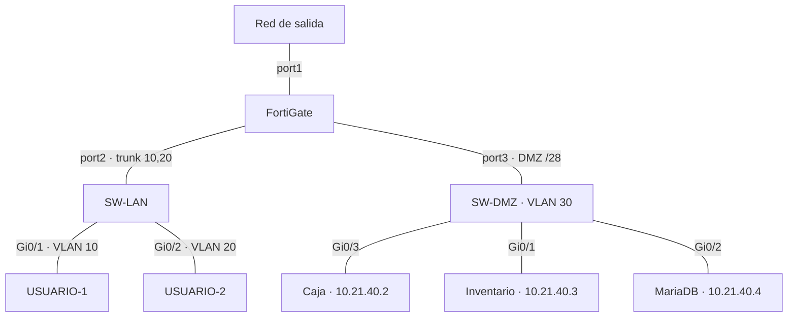
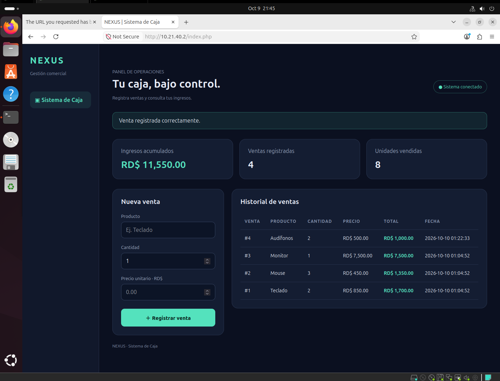
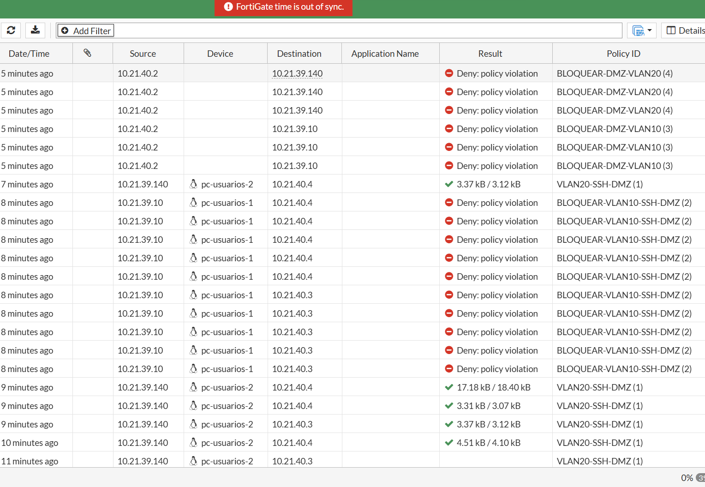

## Video demostrativo

**Pendiente de insertar el enlace del video de esta práctica.** Este bloque se mantiene al principio del repositorio.

# Seguridad de redes con FortiGate · DMZ y VLAN

**Autor:** Adrian Magallanes Feliz · **Entorno:** GNS3, VMware y Ubuntu.

## Propósito del laboratorio

Implementar una infraestructura que separe las redes de usuarios de los servidores de Caja, Inventario y Base de Datos. El FortiGate controla el tráfico entre segmentos, permite la administración SSH exclusivamente desde VLAN 20 y muestra un aviso de bloqueo cuando VLAN 10 intenta acceder al Inventario.

La configuración y demostración del FortiGate se realizan por su interfaz gráfica. Los switches se verifican mediante Cisco IOS y los equipos Ubuntu mediante terminal y navegador.

## Arquitectura

Los switches trabajan como capa 2 para estos segmentos. El enrutamiento entre LAN y DMZ pasa por el FortiGate. Los servidores comparten la VLAN 30; el acceso a MariaDB se restringe también mediante UFW y cuentas por dirección de origen.

| Segmento | Red | Gateway | Asignación |
|---|---|---|---|
| VLAN 10 — Usuarios | 10.21.39.0/25 | 10.21.39.1 | DHCP |
| VLAN 20 — Administración | 10.21.39.128/25 | 10.21.39.129 | DHCP |
| DMZ — Servidores | 10.21.40.0/28 | 10.21.40.1 | Estática |

## Evidencias de implementación

### Sistema de Caja

La captura muestra una venta registrada y los totales de la aplicación.

### Control de acceso en FortiGate

Los registros muestran SSH permitido desde VLAN 20, SSH denegado desde VLAN 10 y conexiones iniciadas desde Caja hacia las dos VLAN denegadas.

### Bloqueo visible de Inventario

El aviso identifica el bloqueo por filtro local de URL. [Ver las 14 capturas y sus explicaciones](evidencias/README.md).

## Documentación

- [Arquitectura y direccionamiento](docs/01-arquitectura.md)
- [Políticas y controles](docs/02-seguridad.md)
- [Guía de demostración: comandos y GUI](docs/03-demostracion.md)
- [Índice de capturas reales](evidencias/README.md)
- [Configuraciones y exportación de running-configs](configs/README.md)
- [Scripts y código de aplicaciones](scripts/README.md)
- [Pendientes de entrega](docs/04-entrega.md)

## Estado de entrega

La documentación y las capturas disponibles están incluidas. Falta incorporar el enlace del video, las exportaciones reales de ambos switches y del FortiGate, y el código completo de las aplicaciones desplegadas. Los archivos de referencia no sustituyen esas exportaciones.

La comprobación completa de descargas de actualizaciones quedó fuera de la demostración final; no se presenta como una prueba superada.
