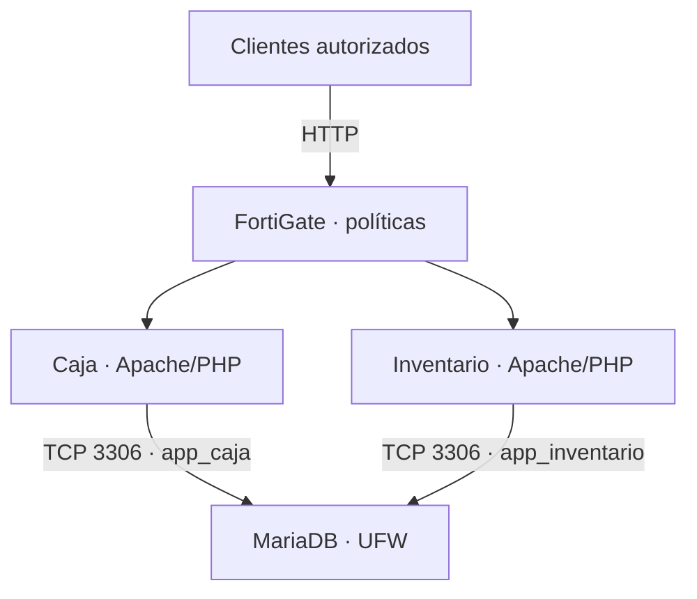

# Arquitectura y direccionamiento

## Inventario

| Equipo | Función | Interfaz / dirección |
|---|---|---|
| FortiGate | Firewall y gateway | port1: WAN por DHCP; port2: trunk; port3: 10.21.40.1/28 |
| SW-LAN | Acceso de usuarios | Gi0/0 trunk VLAN 10,20; Gi0/1 VLAN 10; Gi0/2 VLAN 20 |
| SW-DMZ | Acceso de servidores | Gi0/0 al FortiGate y Gi0/1–3 a servidores, access VLAN 30 |
| USUARIO-1 | Cliente Ubuntu Desktop | DHCP VLAN 10; dirección observada 10.21.39.10 |
| USUARIO-2 | Cliente Ubuntu Desktop | DHCP VLAN 20; dirección observada 10.21.39.140 |
| srv-caja | Apache, PHP y cliente MariaDB | ens3: 10.21.40.2/28 |
| srv-inventario | Apache, PHP y cliente MariaDB | ens3: 10.21.40.3/28 |
| srv-db | MariaDB | ens3: 10.21.40.4/28 |

Los servidores usan gateway y DNS 10.21.40.1. Las direcciones DHCP de las PCs deben confirmarse antes de grabar. La dirección WAN observada del FortiGate fue 192.168.85.183/24 y puede cambiar.

## Aplicaciones y base de datos

Las conexiones entre los servidores de la misma DMZ se conmutan localmente. UFW en srv-db permite TCP 3306 desde Caja e Inventario; cada cuenta de aplicación tiene permisos SELECT, INSERT, UPDATE y DELETE únicamente sobre su propia base.

| Aplicación | URL | Base / tabla |
|---|---|---|
| Caja | http://10.21.40.2/index.php | caja.ventas |
| Inventario | http://10.21.40.3/index.php | inventario.productos |

Las interfaces temporales de instalación no forman parte del diseño final. La demostración utiliza el FortiGate como gateway de la DMZ.
