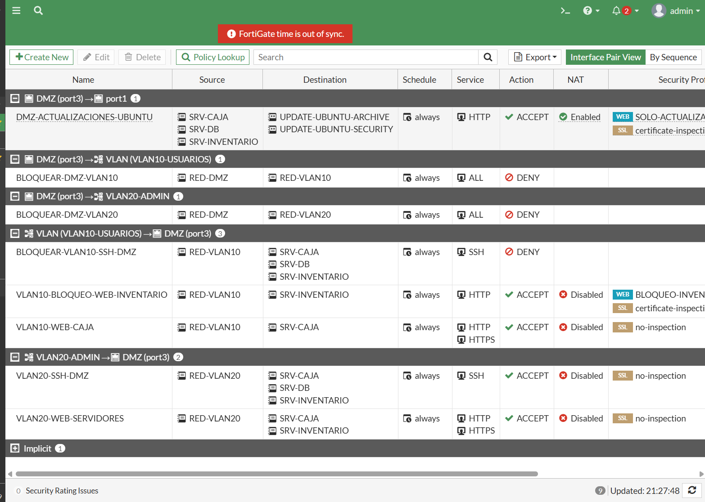

# Políticas y controles

## Matriz de acceso

| Origen | Destino | Servicio | Resultado |
|---|---|---|---|
| VLAN 20 | Tres servidores | SSH TCP 22 | Permitido |
| VLAN 10 | Tres servidores | SSH TCP 22 | Denegado |
| VLAN 10 | Inventario | HTTP TCP 80 | Aviso visible mediante Web Filter |
| VLAN 10 | Caja | HTTP TCP 80 | Permitido |
| VLAN 20 | Caja e Inventario | HTTP TCP 80 | Permitido |
| DMZ | VLAN 10 y VLAN 20 | Conexiones nuevas | Denegado |
| Caja e Inventario | srv-db | MariaDB TCP 3306 | Permitido por firewall local y cuentas de DB |

El bloqueo DMZ → LAN impide conexiones iniciadas desde la DMZ. Las respuestas a sesiones autorizadas iniciadas desde la LAN pertenecen a dichas sesiones.

## Políticas del FortiGate

| Política | Función |
|---|---|
| VLAN20-SSH-DMZ | Administración desde VLAN 20 |
| BLOQUEAR-VLAN10-SSH-DMZ | Denegación SSH desde VLAN 10 |
| BLOQUEAR-DMZ-VLAN10 | Aislamiento hacia usuarios |
| BLOQUEAR-DMZ-VLAN20 | Aislamiento hacia administración |
| VLAN10-BLOQUEO-WEB-INVENTARIO | HTTP con perfil BLOQUEO-INVENTARIO-VLAN10 |
| VLAN10-WEB-CAJA | Acceso a Caja |
| VLAN20-WEB-SERVIDORES | Acceso a ambas aplicaciones |

La regla de Inventario figura como ACCEPT porque el perfil Web Filter aplica el bloqueo y genera el aviso. Las reglas entre LAN y DMZ no utilizan NAT. La captura incluye una regla de actualizaciones existente; su descarga completa no se incluye entre los resultados validados de esta entrega.

## Seguridad de los switches y servidores

- VLAN separadas y trunk limitado a VLAN 10 y 20.
- Port Security en puertos de acceso, con acción Shutdown ante violaciones.
- Puertos sin uso administrativamente desactivados según la configuración trabajada.
- UFW de los servidores web: SSH desde 10.21.39.128/25 y HTTP desde 10.21.39.0/24 por ens3.
- UFW de srv-db: SSH desde VLAN 20 y MariaDB desde 10.21.40.2 y 10.21.40.3.
- MariaDB escucha en 10.21.40.4:3306 y las cuentas de aplicación están asociadas a la IP de su servidor.

La configuración íntegra y vigente debe comprobarse con las exportaciones reales indicadas en [configs](../configs/README.md).
