# Evidencias reales

Capturas proporcionadas durante la implementación. Los nombres se normalizaron sin alterar el contenido.

| Imagen | Qué demuestra |
|---|---|
| [Caja](caja-venta.png) | Aplicación con venta registrada, cuatro ventas y total RD$ 11,550 |
| [SSH desde VLAN 10](ssh-vlan10-denegado.png) | Intentos a .2, .3 y .4 con timeout; interpretar junto con los logs |
| [SSH desde VLAN 20 a DB](ssh-vlan20-db.png) | Sesión abierta en srv-db tras autenticación |
| [Logs](logs-control-acceso.png) | Denegaciones DMZ a LAN, SSH denegado desde VLAN 10 y permitido desde VLAN 20 |
| [Políticas](politicas-fortigate.png) | Matriz visible en la GUI del FortiGate |

## SSH denegado

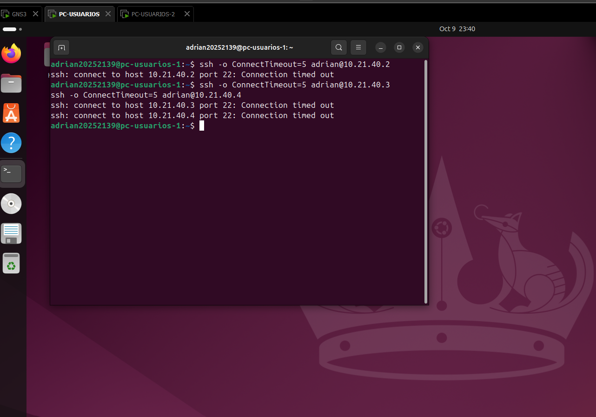

## SSH permitido

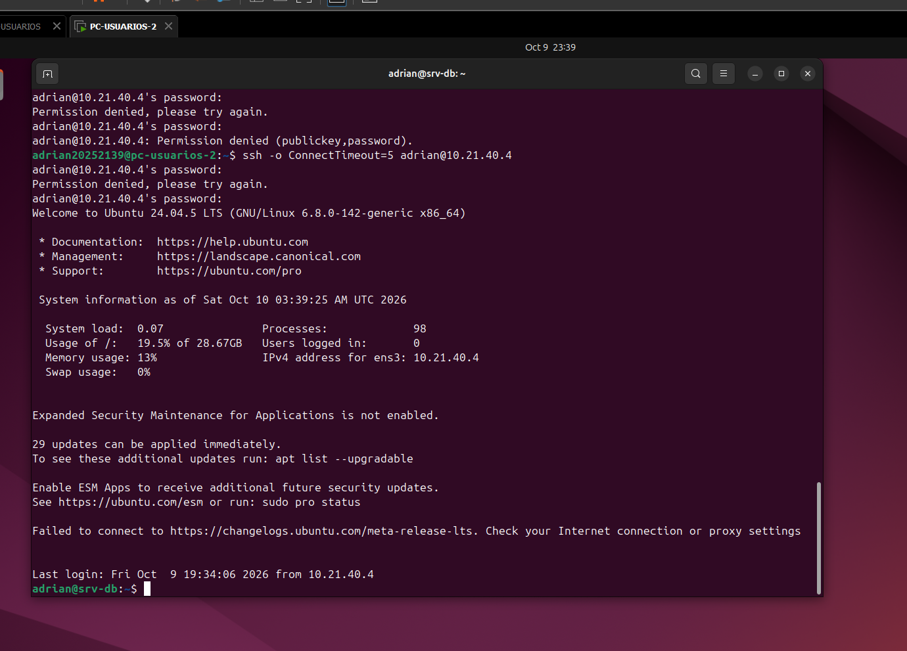

Las capturas son evidencia de la sesión, no un certificado del estado actual. El banner de hora del FortiGate aparece en las capturas originales; no se utiliza para certificar la cronología.

## Evidencias adicionales

Las capturas de formularios documentan los valores durante la configuración; las pruebas de cliente y los logs complementan la evidencia de funcionamiento.

### SSH a Caja

Sesión iniciada desde pc-usuarios-2 hacia 10.21.40.2 y prompt srv-caja. Los errores anteriores corresponden a intentos de autenticación.

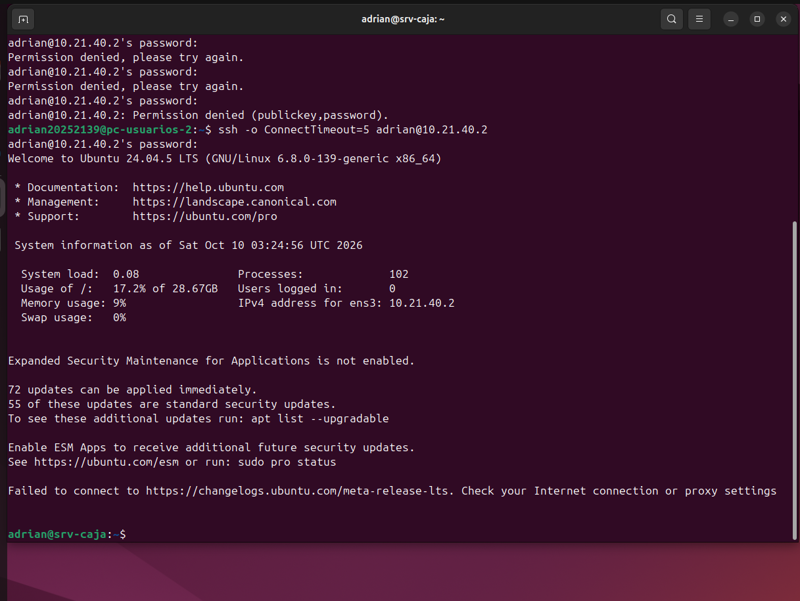

### SSH a Inventario

Sesión abierta en srv-inventario (10.21.40.3). El origen VLAN 20 se corrobora con los logs de control de acceso.

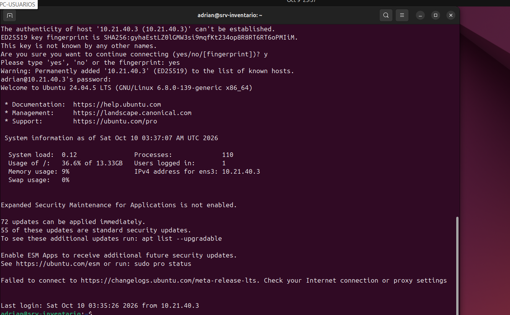

### DHCP VLAN 10

Formulario de configuración: rango 10.21.39.10–126, máscara /25 y gateway de la interfaz.

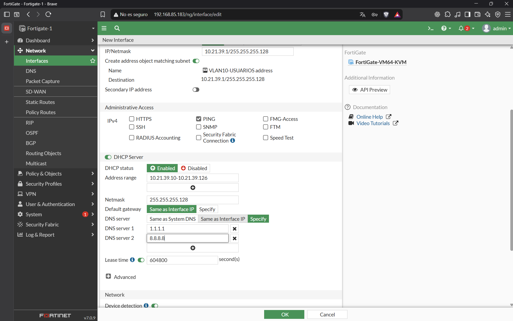

### VLAN 20 y DHCP

Formulario de configuración: VLAN ID 20 sobre port2, gateway 10.21.39.129/25 y rango 10.21.39.140–254.

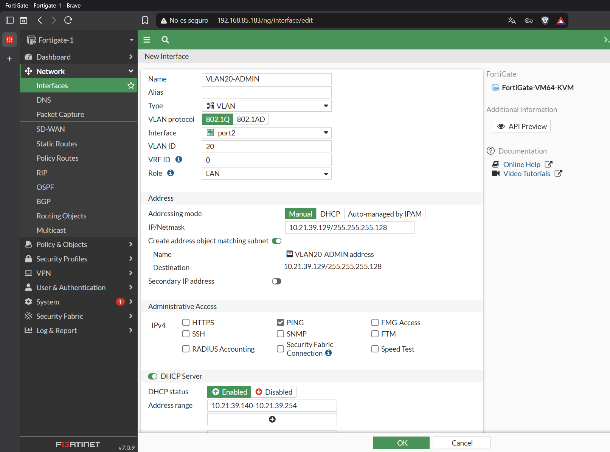

### USUARIO-1 con dirección DHCP

ens33 tiene 10.21.39.10/25 y ruta predeterminada vía 10.21.39.1, identificada como proto dhcp.

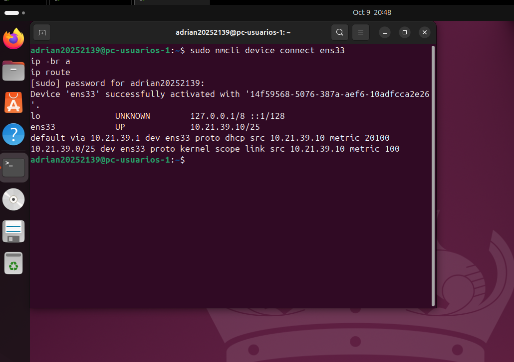

### Aviso visible de Inventario

Firefox muestra Web Page Blocked para 10.21.40.3/index.php, con motivo Local URLfilter Block.

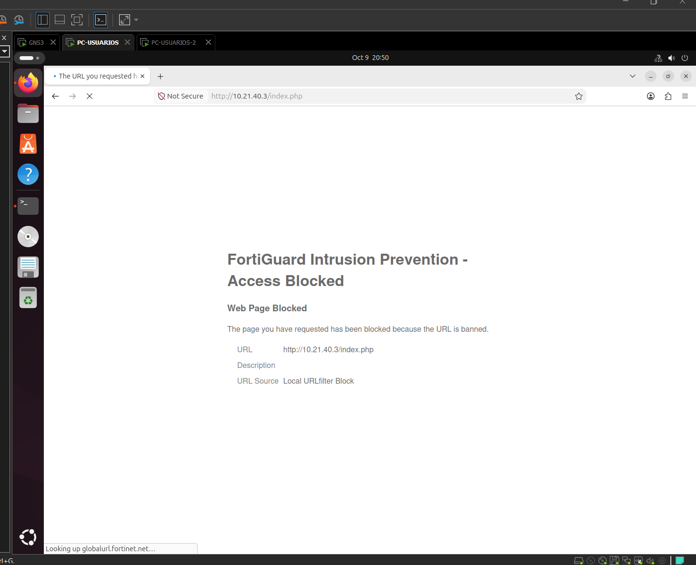

### Log del bloqueo web

Web Filter registra blocked desde 10.21.39.10 hacia /index.php y /favicon.ico de Inventario.

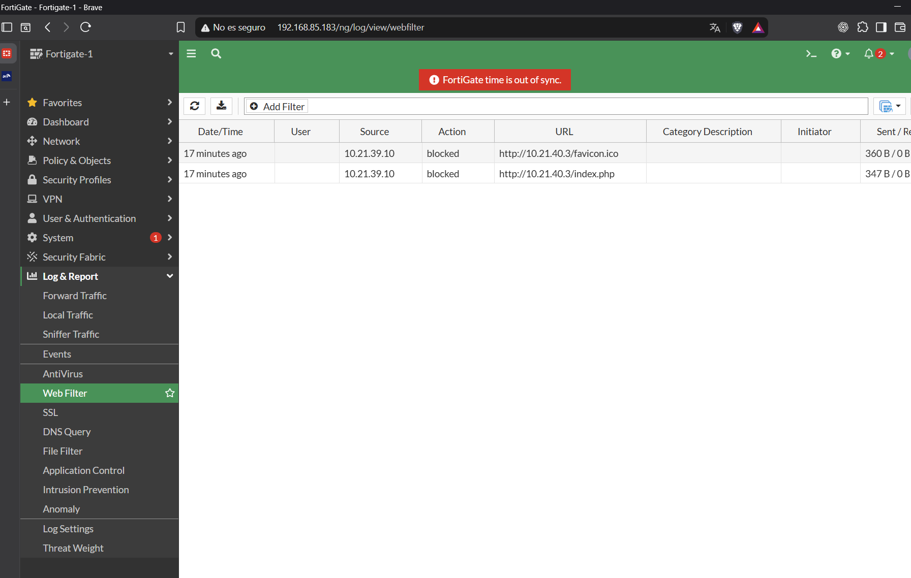

### Perfil de bloqueo de Inventario

Perfil BLOQUEO-INVENTARIO-VLAN10 en Proxy-based con URL Filter habilitado y wildcard * en Block.

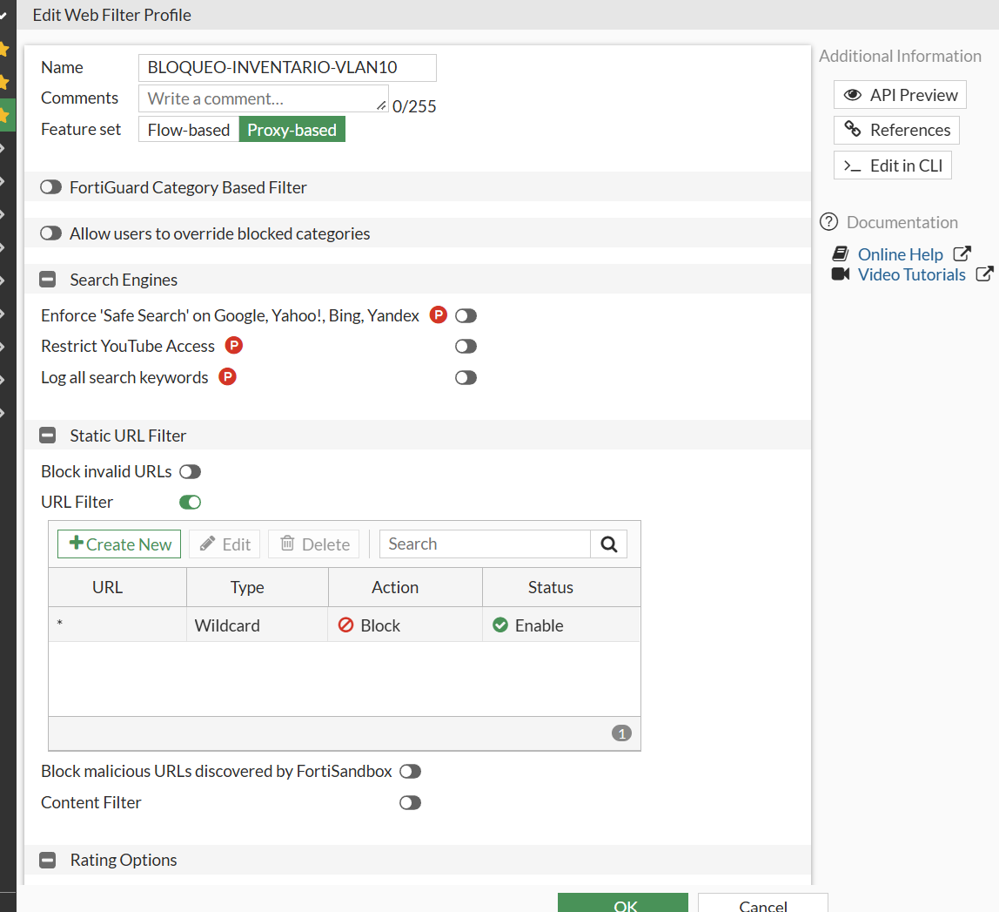

### Política SSH de VLAN 20

Origen RED-VLAN20 (10.21.39.128/25), destino tres servidores, servicio SSH, ACCEPT y NAT desactivado.

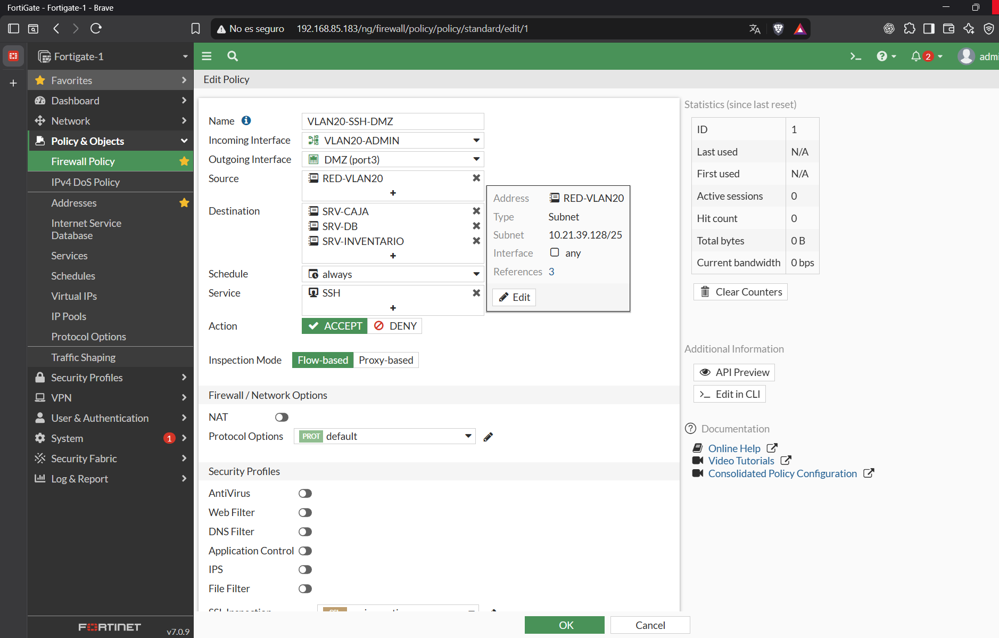

